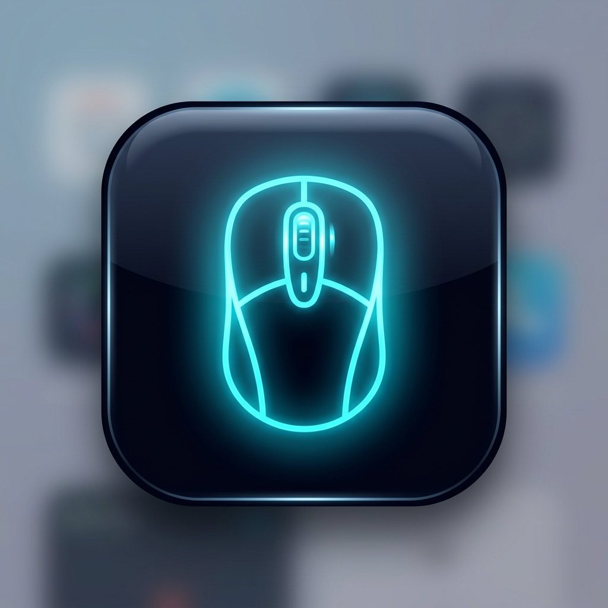
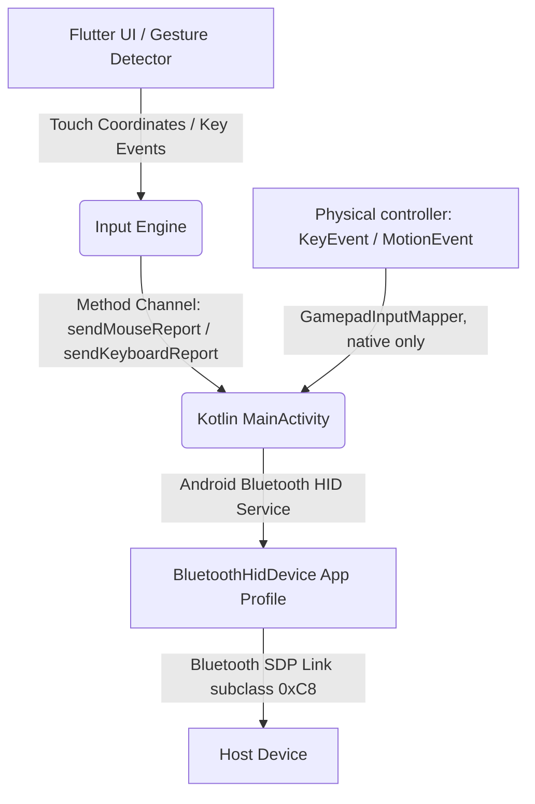

<p align="center">
  
</p>

<h1 align="center">CouchMouse</h1>

<p align="center">
  <a href="https://developer.android.com/reference/android/bluetooth/BluetoothHidDevice">
    
  </a>
  <a href="https://flutter.dev">
    
  </a>
</p>

<p align="center">
  <strong>CouchMouse</strong> is an Android application that turns your device into a driverless Bluetooth HID keyboard and trackpad, and turns Android gaming handhelds into a Bluetooth gamepad. It emulates physical hardware over Bluetooth, working without any client or server software on the host computer.
</p>

---


## Features

### True Driverless Connectivity
No background services, server applications, or desktop clients are needed on your computer. The app works with Windows, macOS, Linux, ChromeOS, iPadOS, and Android TV—any device that accepts standard Bluetooth input.

### Keyboard Layouts
The app includes interactive virtual keyboards supporting six layout options:
- Full-Size (100%): Standard layout with Function keys and a numeric keypad.
- Compact Full-Size (96%): Compressed layout keeping numeric input in a space-efficient form factor.
- Tenkeyless / TKL (80%): Standard layout without the numeric keypad.
- 75% Layout: Compact layout with arrow keys and a vertical navigation bar.
- 65% Layout: Compact layout retaining direct arrow key clusters.
- 60% Layout: Minimalist layout using translation layers for auxiliary keys.

### Trackpad Control
The trackpad provides precise cursor tracking and supports the following settings:
- Adjustable pointer sensitivity (DPI) and scroll speed.
- Toggleable mouse acceleration, scroll momentum, and a trackball mode where a flick keeps the cursor gliding.
- Reversible two-finger scroll direction.
- Left-handed or right-handed trackpad position layouts in landscape mode.
- Mouse click buttons (Left, Middle, Right) and a dedicated scroll wheel zone.

### Interface Modes
- Landscape Mode: Displays a side-by-side view pairing your selected keyboard layout with the trackpad. You can drag the boundaries or swap positions to suit left- or right-handed preferences.
- Portrait Mode: Focuses on single-hand trackpad navigation. Tapping the keyboard button activates the soft keyboard, which opens your device's native system input method editor (IME) to type. The app translates character inputs into HID scan codes, and a quick-access toolbar provides access to modifier keys (Ctrl, Shift, Alt, Win/Cmd), arrow keys, Esc, Tab, and Enter.
- Rich Typing Mode (Settings → Advanced, off by default): in portrait mode, the keyboard opens a visible text box instead, so autocorrect, suggestions and voice typing work. Nothing reaches the host until you tap Send, which types the whole message, with line breaks typed as Enter. Curly quotes, dashes and ellipses are converted to plain characters. The rest of the screen is greyed out while it types. Backspace in an empty box, or the ⌫ toolbar key, deletes on the host.
- Dark Mode (Settings → Advanced, off by default): follows the phone's light or dark system theme.

### Gamepad Mode (Android handhelds)
On devices with built-in controls, such as the AYN Odin and Thor or Retroid handhelds, or on a phone with a controller attached, CouchMouse can forward the physical controls to the host as a standard Bluetooth HID gamepad.
- In **Settings**, turn on **Advanced Settings**, then **Gamepad Mode**. The trackpad and keyboard are replaced by a status screen showing the host connection, the detected controller and a live view of buttons, sticks and triggers.
- Forwards 15 buttons, the D-pad, both analog sticks and both analog triggers. Controllers without analog triggers send a full pull when L2/R2 is pressed.
- Input is captured and sent natively. The Flutter UI is only a status display, so it adds no latency.
- Changes are sent to the host immediately, capped at a report rate you choose in the menu (30, 60, 90 or 125 Hz; default 60). While nothing changes, the full state is still re-sent every 50 ms. That keeps the Bluetooth link from dropping into its slow power-saving mode, and repairs any report Android's Bluetooth stack silently dropped.
- Quick taps are never lost: a button or D-pad press that's released before the next report is still sent as a press, followed by the release.
- If inputs lag or drop on your host, lower the report rate. Sending faster than the Bluetooth link can carry makes reports queue up, which delays every input.
- Stick input is processed as soon as it arrives instead of once per screen frame (Android 11+).
- The screen stays on while gamepad mode is active. Keep CouchMouse in the foreground while playing, because Android only delivers controller input to the focused app.
- The Back, Home and volume keys keep their normal function.

## System Architecture



### HID Descriptors
The device registers itself under subclass code `0xC8` (combo keyboard/mouse `0xC0` plus gamepad `0x08`) using a custom SDP (Service Discovery Protocol) configuration. Keyboard, mouse and gamepad are always registered together as one composite descriptor. Hosts cache the descriptor per pairing, so changing it at runtime would force a re-pair.

#### Keyboard Report (Report ID 1 - 8 Bytes)
- Byte 0: Modifier keys bitmask (Ctrl, Shift, Alt, GUI)
- Byte 1: Reserved padding byte (constant `0x00`)
- Bytes 2-7: Up to 6 active keycode bytes (6-key rollover)

#### Mouse Report (Report ID 2 - 4 Bytes)
- Byte 0: Mouse buttons bitmask (Left Click = `0x01`, Right Click = `0x02`, Middle Click = `0x04`)
- Byte 1: Signed relative X displacement (-127 to 127)
- Byte 2: Signed relative Y displacement (-127 to 127)
- Byte 3: Signed relative scroll wheel vertical movement (-127 to 127)

#### Gamepad Report (Report ID 3 - 13 Bytes)
- Bytes 0-1: 16 buttons, little-endian. Button N is bit N-1, in Linux `BTN_GAMEPAD` order: 1 A, 2 B, 4 X, 5 Y, 7 L1, 8 R1, 9 L2, 10 R2, 11 Select, 12 Start, 13 Home, 14 L3, 15 R3 (3, 6 and 16 unused)
- Byte 2: Hat switch / D-pad in the low nibble (0 = up, clockwise; 8 = centred)
- Bytes 3-10: Left stick X, Y and right stick X (Z), Y (Rz) as signed 16-bit values (-32767 to 32767)
- Byte 11: Right trigger (Simulation: Accelerator), 0-255
- Byte 12: Left trigger (Simulation: Brake), 0-255

## Requirements

### System Requirements
- Android 9.0 (API Level 28) or higher is required. The native `BluetoothHidDevice` APIs do not exist on older versions.
- The host device must support Bluetooth keyboards and mice.

### Gamepad Host Compatibility
CouchMouse appears as a generic HID gamepad, not as an Xbox or PlayStation controller. Android's API does not let an app set the Bluetooth vendor/product ID, so pretending to be an Xbox controller is not possible without root.

| Host | Status |
|---|---|
| Steam (Windows, Linux, macOS, Steam Deck) via Steam Input | Works; configure it as a generic gamepad |
| Linux (evdev / SDL) | Works; buttons map to the standard `BTN_GAMEPAD` codes |
| Android / Android TV | Works |
| Windows games using DirectInput or SDL | Works |
| Windows games that only support XInput | Not detected directly; run them through Steam Input or an XInput wrapper (e.g. x360ce) |
| macOS / iPadOS games using Apple's GameController framework | Not supported; Apple only accepts specific controller models |
| Consoles (Switch, PlayStation, Xbox) | Not supported |

**After updating to a version with gamepad support, unpair and re-pair CouchMouse on the host.** Hosts cache the old keyboard/mouse-only descriptor and won't see the gamepad until you re-pair.

### iOS Support Limitation
This approach cannot be ported to iOS. Apple's CoreBluetooth framework restricts third-party applications from registering or broadcasting standard Bluetooth HID service records (such as HID over GATT or Bluetooth Classic SDP profiles). Consequently, native, driverless keyboard and mouse emulation is not possible on iOS without jailbreaking, private APIs, or an external hardware micro-controller bridge (e.g., an ESP32 or Raspberry Pi Pico) to act as the physical peripheral.

### Required Permissions
The app requests the following permissions at runtime:
- `BLUETOOTH_CONNECT`: Access paired Bluetooth devices.
- `BLUETOOTH_ADVERTISE`: Allow discovery by host systems.
- `BLUETOOTH_SCAN`: Search for host systems.
- `ACCESS_FINE_LOCATION`: Required on older Android SDKs for Bluetooth scanning.

## Development Setup

### Prerequisites
- Flutter SDK (Stable Channel)
- Android SDK (API 28+)

### Installation and Build
1. Clone the repository:
   ```bash
   git clone https://github.com/yourusername/couchmouse.git
   cd couchmouse
   ```
2. Get dependencies:
   ```bash
   flutter pub get
   ```
3. Build and run in release mode:
   ```bash
   flutter run --release
   ```
   *Note: Running in release mode minimizes latency for pointer gestures.*

## How to Use

1. Turn on Bluetooth on both your phone and the host computer.
2. Open CouchMouse and grant the requested permissions.
3. Open the computer's Bluetooth settings.
4. In CouchMouse, tap the connection dashboard and select **Make Discoverable**.
5. Select your phone from the list of available Bluetooth devices on your computer.
6. Once paired, select your host machine from the device list in CouchMouse and press **Connect**.
7. Rotate your screen horizontally for the side-by-side keyboard and trackpad, or hold it vertically for single-hand trackpad use.

### Using a handheld as a gamepad
1. Pair and connect as above. If you paired before gamepad support existed, unpair and re-pair first.
2. Open **Settings**, turn on **Advanced Settings**, then turn on **Gamepad Mode**.
3. Check that your controller is listed and that pressing buttons lights up the on-screen diagram.
4. Leave CouchMouse open and play. Use **Exit Gamepad Mode** or the menu toggle to return to the trackpad.

### Back Up or Move Your Settings

In **Settings**, turn on **Advanced Settings** and choose **Export Settings** to save a binary CouchMouse backup (.pb) with Android’s file picker. On the new installation, turn on **Advanced Settings**, choose **Import Settings**, and select that file. Import replaces your global and per-computer Couch Mouse preferences, including Trackball, Trackball Friction, Gamepad Mode, and the gamepad report rate. Pair your computer in Android’s Bluetooth settings on the new phone.

### Linux: Cursor Lags or Stutters

Linux computers also connect to your phone for call and media audio. On some phones, such as the Galaxy S25, this audio slows CouchMouse down. The cursor freezes while a sound plays, or lags by seconds until you reconnect.

1. On the phone, open Bluetooth settings, tap the gear next to your computer, and turn off **Calls** and **Audio** (**Media audio** on some phones).
2. Disconnect and reconnect in CouchMouse.

**Optional:** if the cursor still lags, stop your computer from connecting audio to phones. Needs WirePlumber 0.5 or newer (`wireplumber --version`). Paste this into a terminal:

```bash
mkdir -p ~/.config/wireplumber/wireplumber.conf.d && cat > ~/.config/wireplumber/wireplumber.conf.d/51-couchmouse.conf <<'EOF'
monitor.bluez.rules = [
  {
    matches = [ { device.form-factor = "phone" } ]
    actions = { update-props = { bluez5.auto-connect = [ ] } }
  }
]
EOF
systemctl --user restart wireplumber
```

Then reconnect in CouchMouse. Your phone can still start audio to the computer itself. To undo:

```bash
rm ~/.config/wireplumber/wireplumber.conf.d/51-couchmouse.conf && systemctl --user restart wireplumber
```

### Signing GitHub Releases

Use the same Android signing keystore for every published APK and keep an encrypted backup of the keystore and its passwords. In GitHub Actions, configure these repository secrets.

- `ANDROID_KEYSTORE_BASE64` containing the base64-encoded keystore
- `ANDROID_KEYSTORE_PASSWORD` containing the keystore password
- `ANDROID_KEY_ALIAS` containing the signing key alias
- `ANDROID_KEY_PASSWORD` containing the signing key password

Set the repository variable `ANDROID_SIGNING_CERT_SHA256` to the SHA-256 fingerprint of the signing certificate. Find it with `keytool -list -v -keystore <keystore> -alias <alias>`. The release workflow verifies this fingerprint before publishing. Enable **verify_only** when testing signing without publishing. Keep the application ID and increment the Android version code for each release. Local development builds can use the debug key.

## Testing
- Flutter tests: `flutter test`
- Native JVM unit tests for the HID gamepad report, descriptor and input mapping (`android/app/src/test`): after `flutter build apk` has generated the Gradle wrapper, run `cd android && ./gradlew :app:testDebugUnitTest`
- Manual hardware checklist for gamepad mode: [`docs/gamepad/TESTING.md`](docs/gamepad/TESTING.md)
